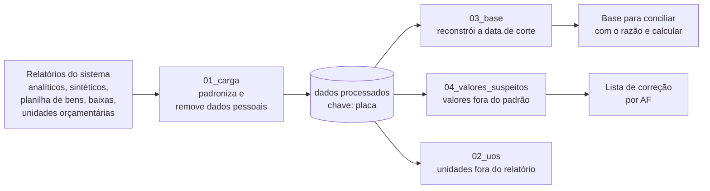

<p align="center">
  
</p>

<h1 align="center">Depreciação Mobiliária</h1>

<p align="center">
  Implantação da depreciação dos bens móveis do município de São José dos Campos (SP)<br>
  <sub>Saneamento da base patrimonial · política contábil · cálculo · especificação do sistema</sub>
</p>

---

## O projeto

O município precisa reconhecer a depreciação dos seus bens móveis, como pedem a NBC TSP 07 (até 2026), a NBC TSP 37 (a partir de 2027) e o MCASP. O sistema de patrimônio não calcula depreciação, e a base cadastral acumula décadas de registros sem histórico.

Este repositório reúne o **método** e os **scripts** usados para:

1. montar uma base confiável de bens a partir dos relatórios que o sistema oferece;
2. reconstruir a posição patrimonial numa data de corte, mesmo sem histórico no sistema;
3. encontrar valores cadastrados errado e propor a correção, rastreando pela autorização de fornecimento (AF);
4. servir de especificação executável para o futuro módulo de depreciação do sistema.

Os dados do município **não estão aqui**. Veja [Proteção de dados](#proteção-de-dados).

## Como funciona



| Script | O que faz |
|---|---|
| `scripts/01_carga.py` | Lê os relatórios exportados (CSV em Latin-1 e Excel), padroniza placa, datas e valores, grava em Parquet e confere a consistência entre eles. Colunas com CPF e nomes nunca são lidas. |
| `scripts/02_uos_sem_termino.py` | Lista os bens de unidades que o relatório analítico deixa de fora mesmo sem data de término. |
| `scripts/03_base_31122025.py` | Reconstrói a base numa data de corte: planilha atual, menos aquisições posteriores, mais baixas posteriores, mais inservíveis que aguardam leilão. Marca cada placa com a origem e problemas de qualidade. |
| `scripts/04_valores_suspeitos.py` | Compara cada bem com a mediana do mesmo código de material e com os itens da mesma AF; propõe valor provável e grau de confiança. |

## O que aprendemos sobre a base

Lições que valem para outros entes com sistemas parecidos:

- **Relatório de ano anterior não é retrato do passado.** Se o sistema não guarda histórico, o "analítico de 2015" é gerado com o cadastro de hoje: bens baixados depois somem e a unidade mostrada é a atual. Para ver uma data passada, reconstrua: *bens atuais − aquisições posteriores + baixas posteriores*.
- **Relatórios têm filtros que não aparecem na tela.** No nosso caso, o analítico escondia unidades orçamentárias com data de término, e os bens "em uso" presos nelas sumiam do total. Cruzar relatórios pela placa revela esses filtros.
- **Status e data de baixa podem não bater.** Há bens com data de baixa e status "em uso": ou voltaram a uso, ou foram baixados e o status ficou errado. O cruzamento com o inventário separa um caso do outro.
- **Patrimônio e Contabilidade baixam em momentos diferentes.** O Patrimônio tira o bem da base quando ele é declarado inservível; a Contabilidade só baixa no leilão. Para conciliar com o razão, os inservíveis que aguardam leilão continuam na base.
- **O erro de valor mais comum é a vírgula deslocada.** Valores digitados 100 ou 1.000 vezes maiores, muitas vezes com dígitos repetidos (1.990.990,00 no lugar de 1.990,99). A mediana do mesmo material, sem os bens anteriores ao Plano Real e sem lotes de carga inicial, encontra esses casos; os itens da mesma AF confirmam o valor certo.
- **Valores anteriores a julho de 1994** foram convertidos de moedas antigas e não servem de referência.

## Como usar

Requer Python 3.11+.

```bash
pip install -r requirements.txt
```

Coloque os relatórios exportados do sistema em `dados/brutos/` e rode os scripts na ordem:

```bash
python scripts/01_carga.py
python scripts/02_uos_sem_termino.py
python scripts/03_base_31122025.py
python scripts/04_valores_suspeitos.py
```

Os nomes dos arquivos, as colunas e as datas de posição estão como constantes no início de cada script. Para outro sistema ou outra data de corte, ajuste essas constantes.

Estrutura esperada:

```
dados/brutos/        relatórios como vieram do sistema (somente leitura, fora do repositório)
dados/processados/   bases em Parquet geradas pelos scripts (fora do repositório)
parametros/          tabela de vida útil e valor residual por classe
docs/modelos/        modelos de pedido de dados à TI e à Contabilidade
scripts/             scripts numerados na ordem de execução
saidas/              planilhas Excel para conferência (fora do repositório)
```

## Modelos de pedido

Dois modelos genéricos para repetir o processo em outro ente:

- [`docs/modelos/pedido_ti_extracao_bens.md`](docs/modelos/pedido_ti_extracao_bens.md): extração completa do cadastro de bens, com status, datas de aquisição, início de uso e baixa.
- [`docs/modelos/pedido_contabilidade_dados.md`](docs/modelos/pedido_contabilidade_dados.md): saldos e lançamentos de baixa para conciliar Patrimônio e razão.

## Proteção de dados

O repositório guarda só o método. Ficam **fora**, por regra no `.gitignore`:

- relatórios do sistema e qualquer base derivada (`dados/`);
- planilhas de saída (`saidas/`), que trazem placas, valores e localização dos bens;
- documentos internos de planejamento e o contexto de trabalho do projeto.

Nos scripts, colunas com CPF de inventariantes e fornecedores não são lidas, e colunas de observação que podem citar pessoas (cautela, motivo de baixa) não vão para as saídas.

## Base normativa

- **NBC TSP 37** – Ativo Imobilizado (CFC, 2025), vigente a partir de 01/01/2027
- **NBC TSP 07** – Ativo Imobilizado (CFC, 2017), vigente até 31/12/2026
- **NBC TSP 23 (R1)** – Políticas contábeis, mudança de estimativa e retificação de erro
- **MCASP 11ª edição** (STN), Parte II – Procedimentos contábeis patrimoniais
- **PIPCP** – Portaria STN 548/2015
- **Lei 4.320/64**, arts. 94 a 96
- **Macrofunção SIAFI 020330** (STN) – referência de vida útil e valor residual

## Andamento

- [x] Carga e diagnóstico da base
- [x] Reconstrução da base na data de corte
- [x] Panorama de valores suspeitos com rastreio por AF
- [ ] Validação com o relatório geral do sistema
- [ ] Conciliação com o razão
- [ ] Tabela de vida útil por classe e simulação
- [ ] Cálculo da depreciação e especificação do módulo do sistema

## Licença

Código e documentação sob a [licença MIT](LICENSE).

---

<sub>Brasão de São José dos Campos: domínio público no Brasil (obra do governo municipal anterior a 1983), via <a href="https://commons.wikimedia.org/wiki/File:Bras%C3%A3o_de_S%C3%A3o_Jos%C3%A9_dos_Campos.svg">Wikimedia Commons</a>. O uso de símbolos oficiais pode ter restrições próprias, independentes de direito autoral.</sub>
